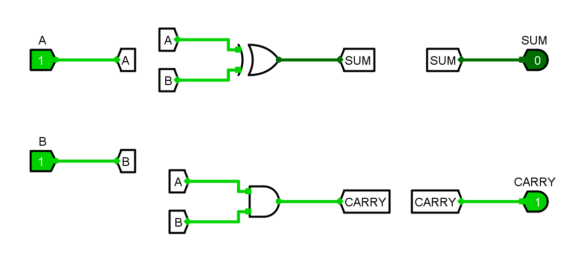

# 在 Codex 中用 Logisim Classic Lab 画电路

这份教程面向已经安装 MCP 服务和 `logisim-classic-lab-workflow` Skill 的用户。你通常只要用自然语言告诉 Codex 要画什么；MCP 负责读取元件、创建和检查 `.circ` 工程，Skill 提醒 Codex 按安全、可验证的步骤完成工作。


## 从打开软件开始

下面按“Codex 让 AI 画图”的实际顺序来操作。MCP 直接调用本机 Logisim 引擎创建 `.circ` 文件；它不是鼠标自动化，所以**让 AI 创建电路时不必先打开 Logisim 窗口**。完成后再用 GUI 打开文件查看或手工调整。

### 第一次使用：启动并确认环境

1. 从 Windows 开始菜单或桌面快捷方式打开 **Codex**，进入一个任务；选择或打开你准备存放电路文件的项目/工作文件夹。输出目录要存在，并且对当前 Codex 有写入权限。
2. 按仓库首页的[安装步骤](https://github.com/Tebie888/logisim-classic-lab-tools#install-mcp)配置 MCP 和 Skill。MCP 配置中的 `LOGISIM_HUST_EXE` 要指向你自己安装的兼容 Logisim 程序；仓库不附带该软件。第一次改完配置后重启 Codex，让它加载 MCP 服务和 Skill。
3. 在对话中发送：

   > 检查 Logisim Classic Lab MCP 是否已连接。请调用 `logisim_env_info` 查询程序版本，并确认你能看到 `build_circuit`、`validate_circuit`、`check_connections`、`export_circuit_image`。先只报告状态，不要创建或修改文件。

4. 确认 Codex 报告了可用的程序路径、版本和工具。如果它说工具不存在，先检查 Codex 的 MCP 配置和服务器日志并重启；如果报告找不到 Java 或 Logisim，检查 `LOGISIM_HUST_EXE` 和 Java 安装。此时不要继续要求它画图。

### 每次画图：从需求到文件

1. 选“新建电路”或“修改现有工程”。新建时给一个**尚不存在的 `.circ` 文件名**；修改时给现有文件路径并明确允许修改的电路。不要让 AI 猜测哪个工程或覆盖哪个文件。
2. 按下一节的需求模板写输入、输出、逻辑和验收条件。组合逻辑尽可能给真值表；时序电路说明时钟边沿、复位和使能。
3. 让 Codex 按 Skill 查询真实元件和端口，先用 `dry_run=true` 预览。检查它返回的元件、连接、位宽和位置摘要；出现错误就先修正预览。
4. 预览正确后，让 Codex 用相同设计正式创建或编辑电路，再做运行时结构检查和预期网络检查。不要让它为了让检查通过而改写功能要求。
5. 要求 Codex 按你列出的每一个向量实际测试，并把期望值与实际值并列报告。让它导出 PNG、查看图中网络标签和元件显示是否遮挡；需要调整时先改布局，再重做受影响的检查和导图。
6. 在 Codex 输出中找到 `.circ` 和 `.png` 的路径。打开 Logisim GUI：从 Windows 开始菜单启动兼容的 Logisim 程序，选择 **File → Open**（文件→打开），选择生成的 `.circ`。若文件关联配置正确，也可以在文件管理器中双击 `.circ`。
7. 在 Logisim 中查看并交互测试：点击输入 Pin 改变 0/1，观察输出；如果手工改了电路，保存后回到 Codex，要求它重新运行受影响的检查和测试。不要同时在 Codex 和 GUI 中改写同一个文件。


## 先确认连接正常

在 Codex 中要求：

> 请用 `logisim_env_info` 检查 Logisim、Java 和当前 MCP 服务是否可用，并确认工程格式是经典 Logisim。

若 MCP 已连接，环境查询应能识别可用程序和版本，工具列表应包含 `build_circuit`、`validate_circuit`、`check_connections` 和 `export_circuit_image`。遇到 Logisim Evolution 4.x 工程时先停下：本工具不支持对该格式编辑或仿真。

MCP 是实际执行操作的工具接口；Skill 是指导 Codex 如何选元件、读取真实端口、检查电路和审阅图片的工作说明。它们都不会代替你提供功能要求。先说清输入、输出、位宽和期望行为，画出的电路才有明确的验收标准。

## 给 AI 的需求模板

建议直接复制这段并把方括号内容填完整。路径要改成你机器上**已存在的输出文件夹**；文件名本身应是新的。如果资料不全，要求 Codex 先提问，不要凭猜测补功能。

```text
请使用 logisim-classic-lab-workflow Skill 和 Logisim Classic Lab MCP 完成下面的电路。

【工程模式】新建 / 修改现有工程（二选一）
【目标文件】C:/circuits/my-circuit.circ
【要创建或修改的电路】[电路名；修改时说明允许改哪些部分]
【输入】[名称、方向、位宽、有效电平，例如 A: 1 位输入]
【输出】[名称、位宽]
【功能】[逻辑表达式、状态变化说明或真值表]
【时钟/复位/使能】[无；或分别说明边沿、电平和行为]
【布局】输入在左、输出在右；[其他位置/分区/标签要求]
【验收测试】[每组输入/时钟刺激] -> [预期输出]
【输出文件】保存 .circ；另导出 [PNG 路径] 的预览图
【安全要求】先读取工程/元件端口并 dry-run；不要覆盖已有文件；不要擅自改变接口。
【完成报告】列出检查、每组测试的期望值和实测值，以及 .circ 和 PNG 路径。
```

对新建电路，常用的最短请求是：

> 新建一个半加器，保存到 `C:/circuits/half-adder.circ`。输入 A、B；输出 SUM=A XOR B、CARRY=A AND B。先确认环境并查询 XOR/AND 元件的真实端口，使用 readable 布局，dry-run 通过后再创建。用 00、01、10、11 四组输入验证，导出 PNG 并报告期望/实际值和文件路径。不要覆盖已有文件。

### 描述你要画的电路

新建电路时，可以复制下面的格式并替换内容：

> 请新建经典 Logisim 电路，保存到 `C:/circuits/half-adder.circ`。画一个半加器：输入 Pin 为 A、B；输出 Pin 为 SUM、CARRY；功能为 SUM=A XOR B，CARRY=A AND B。使用清晰的从左到右布局和可读标签。先检查当前 Logisim 的元件目录与端口，再 dry-run 预览；通过后创建文件，做结构、连通性检查，并用 00、01、10、11 四组输入验证输出。最后导出一张 `half-adder-preview.png`，告诉我两个文件的路径和检查结果。不要覆盖已有文件。

如果你已经有工程，就把“新建”和目标路径改为已有 `.circ` 路径，并要求 Codex 先读取主电路、现有 Pin 和当前网络，再说明准备怎么改。明确标出哪些电路或元件可以改；没有指明时不要猜测要删除什么。

功能描述尽量具体，例如用真值表说明行为：

| A | B | SUM | CARRY |
|---:|---:|---:|---:|
| 0 | 0 | 0 | 0 |
| 0 | 1 | 1 | 0 |
| 1 | 0 | 1 | 0 |
| 1 | 1 | 0 | 1 |

复杂电路还要说明总线位宽、时钟边沿、复位电平、使能条件、halt 引脚和需要测试的状态。若作业规定了元件名称、接口或布局，也一并写上。

## Codex 会怎样把要求变成图

典型流程如下：

1. **读取环境和元件。** `logisim_env_info` 确认运行环境；`list_component_catalog` 查询真实元件名称和属性；必要时读取 `get_component_ports` 返回的端口编号、方向与位宽。端口编号可能随元件属性和 Logisim 版本变化，不能凭印象填写。
2. **先预览，再创建。** 用 `build_circuit` 创建单电路，或用 `build_project` 一次创建主电路和多个子电路。`dry_run=true` 只返回候选工程、端口和布局摘要，不会写文件。预览确认后再提交创建。
3. **检查连接。** 用 `validate_circuit(runtime=true)` 做结构与运行时检查；用 `check_connections` 检查实际网络是否与预期端点清单一致。工具能检查多驱动、位宽冲突和错误短接，但只有给出预期网络清单时，才能判断同位宽的线是否接错。
4. **按输入测试。** 明确列出要验证的输入组合和期望输出。`get_truth_table` 是兼容别名，不会自动遍历所有输入。简单组合电路可用 `export_circuit_image` 的 `inputs` 逐组施加输入并核对返回的 `pin_values`；时钟电路要明确设置 `steps` 或 `ticks`。
5. **导出并查看图。** `export_circuit_image` 用 Logisim 自身的绘图和仿真引擎生成 PNG，同时报告仿真后的 Tunnel、元件和 Probe 显示框遮挡情况。查看图片后，如需调整元件位置或标签间距，再重新检查和导出最终图片。

新建工程路径必须指向不存在的文件；MCP 不会覆盖已有工程。修改旧工程时会自动保存原始字节备份，并在候选校验成功后才提交。MCP 负责生成 `.circ` 和 PNG，但不会替你点击 Logisim GUI；需要手工操作时，在 Logisim 中打开生成的 `.circ` 文件即可。

## 看懂半加器示例

仓库提供已经构建并测试过的示例：[`half-adder.circ`](https://github.com/Tebie888/logisim-classic-lab-tools/blob/main/examples/half-adder.circ)。下图是将 A=1、B=1 后导出的状态图；此时 SUM=0、CARRY=1。



它由两个输入 Pin、一个 XOR Gate、一个 AND Gate 和两个输出 Pin 组成。A、B 分别接到两种门，XOR 的输出接 SUM，AND 的输出接 CARRY。示例经过四组输入检查，预期结果为 `00→00`、`01→10`、`10→10`、`11→01`（输出顺序为 SUM、CARRY）。

MCP 的可读布线会在较长或分支网络上使用同名 Tunnel。图上重复出现的网络标签表示同名节点相连；导出后的 PNG 是电路图状态预览，不是鼠标操作过程的 GUI 截图。

## 直接看一次工具调用

Codex 通常会根据你的自然语言请求自动选工具。若要手动理解调用结构，下面是 `build_circuit` 的简化示意；把 `file` 换成自己有权限写入、且尚不存在的绝对路径：

```json
{
  "file": "C:/circuits/half-adder.circ",
  "circuit": "main",
  "dry_run": true,
  "layout": "readable",
  "components": [
    {"id": "A", "name": "Pin", "loc": "(100,100)", "attrs": {"label": "A", "tristate": false}},
    {"id": "B", "name": "Pin", "loc": "(100,200)", "attrs": {"label": "B", "tristate": false}},
    {"id": "xor", "name": "XOR Gate", "loc": "(320,100)"},
    {"id": "and", "name": "AND Gate", "loc": "(320,240)"},
    {"id": "SUM", "name": "Pin", "loc": "(560,100)", "attrs": {"label": "SUM", "output": true, "facing": "west"}},
    {"id": "CARRY", "name": "Pin", "loc": "(560,240)", "attrs": {"label": "CARRY", "output": true, "facing": "west"}}
  ],
  "nets": [
    {"name": "A", "endpoints": [{"id": "A", "port": 0}, {"id": "xor", "port": 1}, {"id": "and", "port": 1}]},
    {"name": "B", "endpoints": [{"id": "B", "port": 0}, {"id": "xor", "port": 2}, {"id": "and", "port": 2}]},
    {"name": "SUM", "endpoints": [{"id": "xor", "port": 0}, {"id": "SUM", "port": 0}]},
    {"name": "CARRY", "endpoints": [{"id": "and", "port": 0}, {"id": "CARRY", "port": 0}]}
  ]
}
```

这是预览参数，不是通用端口表。实际调用前应让 Codex 查询当前运行时的元件库与端口；`dry_run` 通过后，再用相同参数和 `dry_run=false` 创建。然后为每个测试组合调用导图工具，且每次使用不同的 PNG 文件名，因为工具不会覆盖已有图片。

例如测试 A=1、B=1 的导图调用包含：

```json
{
  "file": "C:/circuits/half-adder.circ",
  "output": "C:/circuits/half-adder-11.png",
  "inputs": {"A": 1, "B": 1},
  "scale": 2
}
```

检查返回值中的 `pin_values`：SUM 应为 `0`，CARRY 应为 `1`。`layout_report` 中若出现重叠，再调整布局并导出新文件复查。

## 常见情况

- **工具列表里没有这些工具：** 重启或重连 Codex，让它重新加载 MCP 配置；确认启动的路径指向 `logisim-classic-lab-mcp`。
- **提示找不到程序或 Java：** 检查 `LOGISIM_HUST_EXE` 是否指向本机兼容的 Logisim 程序，确认 Java 能从命令行运行。程序本身不随仓库分发。
- **找不到 `PortProbe.class` 或 `CircuitImage.class`：** 按仓库 README 的步骤，用兼容的 Logisim 程序和 `javac --release 8` 编译附带 Java 源码。
- **`dry_run` 报错：** 先看返回的元件名、属性、端口位宽和错误网络；不要用未经检查的端口号强行继续。
- **图能生成但读起来挤：** 给元件留出更多间距，简化长标签，或调整 `label_spacing`、`tunnel_offset`；按最终导出的整图和局部确认，而不是只依据缩小后的截图。
- **仿真没有停：** 没有 halt 输入的 `-tty` 仿真可能一直运行。给仿真设置超时，或把实际停止信号接到标签严格为 `halt` 的 Pin。

更多参数、端口与布局说明见 [完整搭建参考](full-circuit-building.md)。
